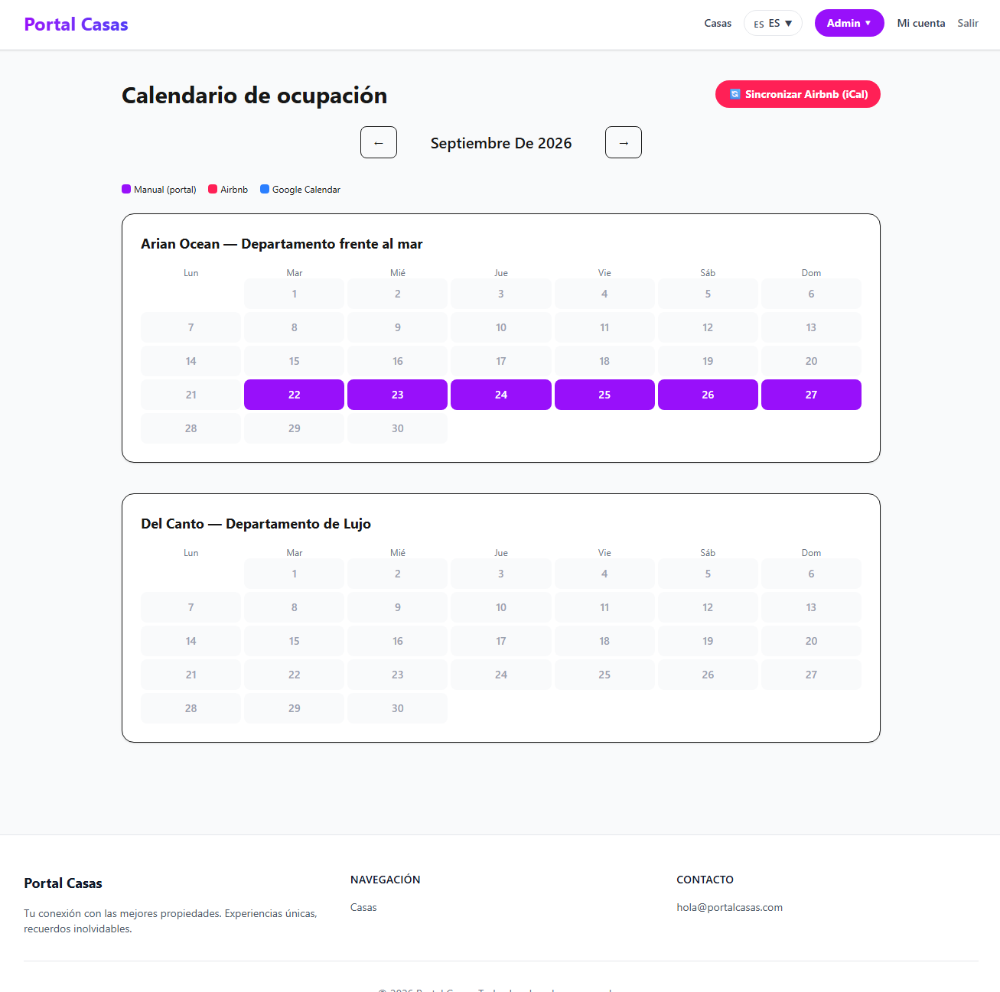
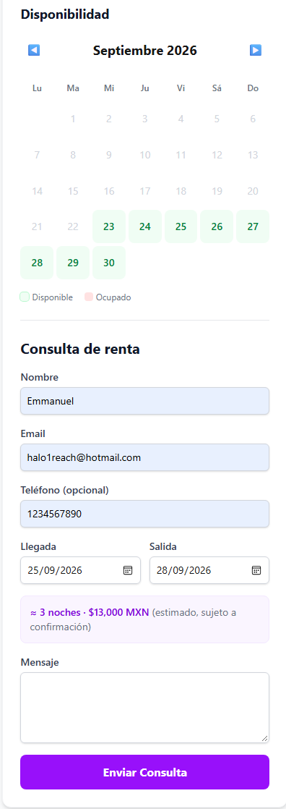
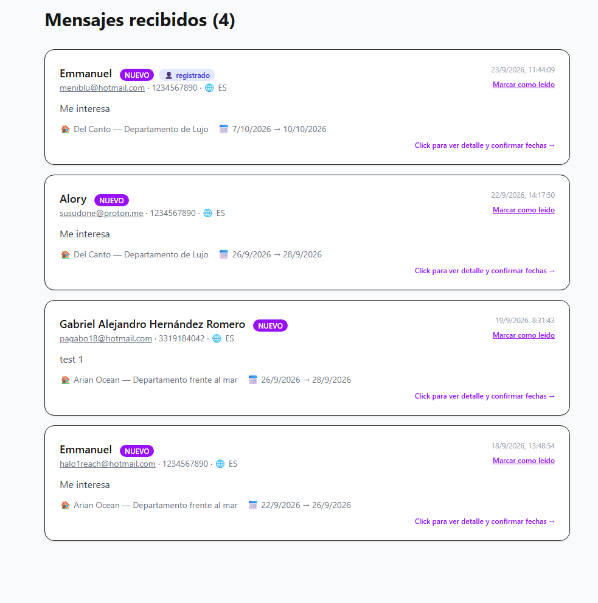

# portal-casas · ALIA FOR RENT

Portal de rentas vacacionales y anuales: catálogo público de casas en es/en/fr, consultas de huéspedes, confirmación de reservas, calendario de ocupación con sincronización iCal (Airbnb) y panel para administrar propiedades y contenido del sitio.

## Estado y documentación

| Documento | Para qué |
|---|---|
| [docs/MAPA-DEL-PROYECTO.md](./docs/MAPA-DEL-PROYECTO.md) | **Empezar aquí.** Qué archivo controla cada parte y cómo se conectan |
| [docs/PROGRESO.md](./docs/PROGRESO.md) | Entregas, verificaciones y pendientes |
| [docs/CONTEXTO.md](./docs/CONTEXTO.md) | Decisiones y arquitectura (contrastar fechas: el código manda) |
| `docs/DIAGNOSTICO-*.md` | Diagnósticos puntuales (iCal, video del hero, renta…) |

## Stack

Monorepo **pnpm 12** · **Next.js 16** (App Router, Turbopack) · **React 19** · **Tailwind 4** · **Auth.js 5** (Credentials/JWT) · **next-intl 4** · **Drizzle ORM** sobre **PostgreSQL/Neon** · **Vercel Blob** (fotos y videos) · **Resend** (correo) · **node-ical** (feeds de Airbnb).

```text
apps/web/        Aplicación Next.js (rutas en src/app/[locale], lógica en src/lib)
packages/db/     Esquema Drizzle (src/schema.ts) y conexión a Neon
scripts/         Tests offline (test-*.cjs), QA y SQL manual (scripts/sql)
docs/            Mapa, contexto, progreso y diagnósticos
```

## Arranque local

1. `pnpm install`
2. Crear `apps/web/.env` a partir de [.env.example](./.env.example). Variables: `DATABASE_URL`, `AUTH_SECRET`, `BLOB_READ_WRITE_TOKEN`, `PUBLIC_SITE_URL` (y opcionales `RESEND_API_KEY`, `EMAIL_FROM`).
   - **`DATABASE_URL` debe apuntar a la rama Neon *Respaldo*,** nunca a producción, para desarrollar.
   - El token de Blob puede ser el del store de producción: lo que se suba desde local queda ahí.
3. `pnpm dev` → http://localhost:3000

## Comandos

```powershell
pnpm dev                                                        # servidor de desarrollo
pnpm lint                                                       # ESLint
pnpm --filter @portal/web exec tsc --noEmit --incremental false # TypeScript
node scripts/test-<nombre>.cjs                                  # un test offline
```

La suite son los `scripts/test-*.cjs` (61 al 9-nov-2026): corren sin red ni Neon, con SQLite en memoria (`test-property-access.cjs` es el arnés). Para correrla entera, ejecutar cada archivo y revisar el código de salida. `test-panel.cjs` falla desde `21dd8412` (permiso de publicación) y está pendiente de actualizar.

`pnpm build` puede consultar la BD; `db:push` y los scripts de `scripts/sql` **modifican datos**: no ejecutarlos sin revisar el entorno.

## Cambios de base de datos

Los cambios de esquema van como SQL manual en `scripts/sql/` y **se aplican antes del deploy**: primero en **Respaldo**, se verifica (cada archivo trae consultas de verificación) y después en **main**. Si el código se despliega sin su SQL, las consultas que leen la tabla afectada fallan.

## Flujo de trabajo

- Cada trabajo nuevo se registra como tarea en Motorcyto (con horas estimadas); los análisis sin código no.
- Ramas: `alia/T-<folio>_descripcion` (por ejemplo `alia/T-4683_whatsapp-limpieza`), PR a `main`.
- El deploy a Vercel lo hace el equipo.

## Vista previa

### Panel de administración — Calendario de ocupación


### Cotizador de precio en vivo


### Panel de mensajes con etiquetas de usuario registrado


## Idiomas disponibles
🇪🇸 Español · 🇬🇧 English · 🇫🇷 Français
