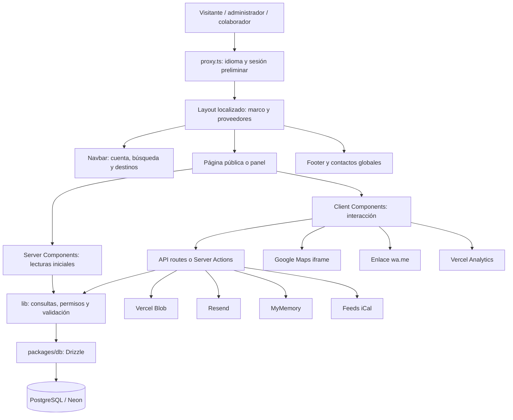
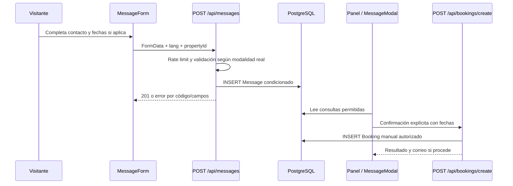
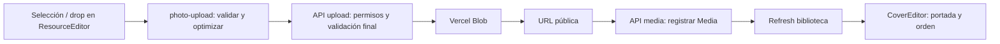
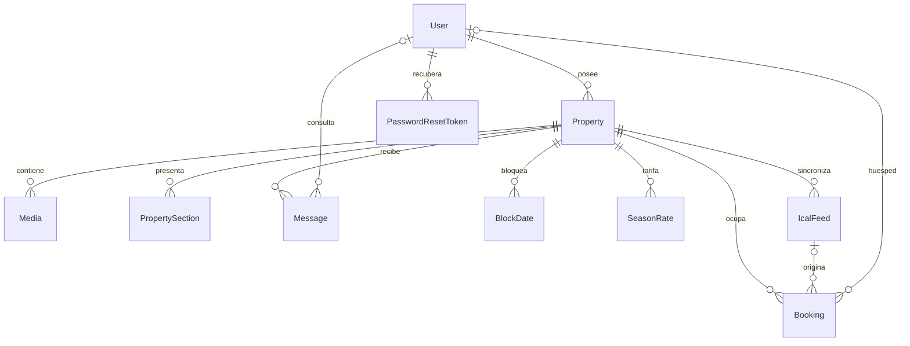

# Mapa del código y funcionamiento de portal-casas

**Revisión:** 29 de octubre de 2026. **Referencia Git:** `4dab447d`, rama `main` al revisar, más los archivos locales presentes.

Esta guía permite localizar qué archivo controla cada parte del proyecto y cómo se conecta con las demás. Describe fuentes del repositorio; no certifica el despliegue, los datos de Neon ni el estado de migraciones aplicadas. No se consultó la BD ni se ejecutaron navegador, build o migraciones para crearla.

**Raíz local:** `C:\Users\menib\Documents\GitHub\portal-casas`. Las rutas cortas son relativas a esa raíz. Los enlaces del inventario abren archivos locales y deben actualizarse si se mueve el checkout.

## Índice

1. [Estructura y arquitectura](#1-estructura-y-arquitectura)
2. [Recorridos funcionales](#2-recorridos-funcionales)
3. [Modelo de datos](#3-modelo-de-datos)
4. [Estilos, idiomas y estados reversibles](#4-estilos-idiomas-y-estados-reversibles)
5. [Configuración, integraciones y ejecución](#5-configuración-integraciones-y-ejecución)
6. [Guía rápida para localizar cambios](#6-guía-rápida-para-localizar-cambios)
7. [Inventario enlazado de archivos](#7-inventario-enlazado-de-archivos)

## 1. Estructura y arquitectura

Monorepo pnpm con dos piezas principales: `apps/web` es la aplicación Next.js; `packages/db` expone conexión y esquema Drizzle. El esquema vigente es Drizzle/PostgreSQL: las referencias históricas a Prisma no describen la implementación actual.

```text
portal-casas/
├── apps/web/
│   ├── src/app/          Rutas, layouts, APIs, loading y CSS global
│   ├── src/components/  Interfaz pública y componentes panel/
│   ├── src/lib/         Reglas, consultas, validaciones y permisos
│   ├── src/i18n/        Routing y carga de idioma
│   ├── src/data/        Datos de ejemplo conservados
│   ├── messages/        Diccionarios es/en/fr
│   ├── public/          Imágenes, video, fuentes y archivos estáticos
│   └── vercel.json      Headers y CSP Report-Only
├── packages/db/
│   ├── src/schema.ts    Tablas, columnas, índices y CHECK
│   ├── src/index.ts     Conexión Neon + Drizzle
│   └── migrations/      SQL histórico de ownership
├── scripts/             Tests y herramientas de mantenimiento
│   └── sql/             SQL manual/propuestas por fase
├── docs/                Decisiones, progreso, diagnósticos y QA
├── package.json         Comandos del monorepo
└── pnpm-workspace.yaml  Workspaces y overrides
```

Versiones declaradas al revisar: pnpm 12.4.1, Next 16.3.4, React 19.2.8, Tailwind 4, Auth.js 5 beta y next-intl 4. Las versiones instaladas/resueltas se consultan en los manifiestos y lockfile, sin modificarlos para leer esta guía.



- **Servidor:** consulta BD, valida permisos/datos y escribe. Los secretos no se envían al cliente.
- **Cliente:** estados, fechas seleccionadas, modales, cola de fotos y controles interactivos.
- **`[locale]`:** es/en/fr; **`[slug]`:** ficha pública; **`[id]`:** recurso del panel/API.
- Un menú visible no concede permisos: revisar proxy, página, helper y endpoint.

### Entradas principales

| Zona | Ruta | Fuente principal |
|---|---|---|
| Home | `/[locale]` | `app/[locale]/page.tsx` |
| Listado/búsqueda | `/[locale]/casas` | `app/[locale]/casas/page.tsx` |
| Ficha | `/[locale]/casas/[slug]` | `app/[locale]/casas/[slug]/page.tsx` |
| Acceso/registro | `/[locale]/login`, `/registro` | Sus page.tsx + actions.ts |
| Recuperación | `/[locale]/olvide-password`, `/reset-password` | Sus page.tsx + actions.ts |
| Cuenta | `/[locale]/mi-cuenta` | page.tsx + actions.ts |
| Propiedades gestionadas | `/[locale]/panel` | `app/[locale]/panel/page.tsx` |
| Crear/editar propiedad | `/panel/nueva`, `/panel/propiedades/[id]` | Composición de editores |
| Mis consultas | `/[locale]/panel/consultas` | Página servidor + Inquiries |
| Calendario | `/panel/calendario`, `/admin/calendario` | Páginas + CalendarBoard |
| Usuarios | `/panel/usuarios`, `/panel/usuarios/[id]` | Páginas + admin-users.ts |
| Contenido global | `/[locale]/panel/contenido` | SiteContentEditor |
| Mensajes | `/[locale]/admin/mensajes` | Página + MensajesList + MessageModal |
| Tarifas | `/[locale]/admin/tarifas` | Página, components.tsx y actions.ts |

Todas las rutas completas y sus archivos están enlazados en el inventario final. No se encontraron páginas públicas dedicadas por destino: los enlaces usan parámetros de `/casas`.

## 2. Recorridos funcionales

### 2.1 Home, menú y búsqueda

1. `proxy.ts` aplica idioma y sesión preliminar. `[locale]/layout.tsx` compone Navbar, Footer, AuthProvider, Analytics y FooterContactsProvider.
2. Layout obtiene SiteContent y destinos publicados en paralelo. Navbar recibe los destinos para menú hamburguesa y formulario de lupa.
3. Home lee contenido global/destacadas. Primera línea: `home.bienvenida`; segunda: `home.heroBrand = ALIA FORRENT`. El texto anterior `home.propiedadesEnRenta` se conserva para reversión.
4. `PropertySearchForm` envía GET: `state`, `destinationCity`, `start`, `end`, `guests`.
5. `property-search.ts` interpreta/valida filtros; el SQL de `/casas/page.tsx` aplica publicación, ubicación, capacidad y ocupación. Con fechas excluye `rentalType=anual`.
6. `published-destinations.ts` agrupa pares válidos de propiedades publicadas. React.cache deduplica durante render servidor, compartido por layout/listado; no hace polling ni fetch al abrir el menú.
7. Un destino válido antiguo sin publicadas permanece seleccionado si viene activo en URL. El listado puede mostrar vacío sin borrar el filtro. Parejas fuera del catálogo siguen rechazándose.
8. PATCH de publicación/ubicación invalida el layout. Una pestaña que ya estaba abierta necesita refresh/recarga; no existe sincronización push entre usuarios.

### 2.2 Ficha pública

1. `seo-property.ts` obtiene la propiedad publicada. La página carga datos relacionados en paralelo y genera metadata localizada.
2. `PropertyGallery` compone principal, franja y dialog lightbox. Los controles inline y del lightbox son elementos distintos: corregir uno no debe alterar el otro.
3. `editorial-presentation.ts` prepara slides con datos reales; `EditorialPresentation` los presenta. Se omiten secciones vacías.
4. `section-modules.ts` interpreta activación/orden; Reserva permanece al final. Los módulos apagados no se renderizan públicamente.
5. `PropertyDetailScroll` controla navbar, ancla `#reservar` y botón ↑; `Reveal` las entradas al viewport.
6. `LocationMap` muestra iframe Google Maps; `PropertyShareButton` comparte ubicación con Web Share o copia.
7. `DetailFooterFlow` mantiene Footer en flujo natural después del contenido.

**Estado del experimento:** `DETAIL_FULLPAGE_ENABLED=false` en la ficha. El motor histórico se conserva en EditorialPresentation, pero no confundir su presencia con fullpage activado.

### 2.3 Consulta y reserva confirmada son operaciones diferentes



- `MessageForm` no es un checkout de pago. Crear Message no crea automáticamente Booking.
- Anual: formulario de contacto sin fechas/huéspedes; el servidor verifica `rentalType`.
- Nocturna/ambas: `AvailabilityCalendar` y MessageForm comparten fechas mediante `ReservationDatesProvider`.
- `/api/messages` actual escribe Message: no asumir correo por cada consulta. El correo de confirmación vive en `/api/bookings/create`.
- La cotización pública se calcula en `MessageForm.tsx` con precios base/temporadas; `Inquiries.tsx` tiene una estimación más limitada y omite total si no puede calcularlo de forma fiable. `reservationDates.ts` valida fechas y rangos, no tarifas.
- `Inquiries` y `MensajesList` abren MessageModal. Sus ajustes temporales de fechas no significan editar la consulta original.
- Analytics registra `query_submitted` tras éxito y `whatsapp_clicked`; no envía nombre/email/teléfono como propiedades del evento.

### 2.4 Editor de propiedad

1. Página servidor verifica gestor y ownership mediante `panel-server.ts` / `property-access.ts`.
2. `PropertyForm`: datos básicos, modalidad, contactos y ubicación.
3. `PropertyPresentationEditor`: títulos por idioma y video de hero.
4. `PropertyRentalType`: oculta recursos de anual sin borrar datos.
5. `ResourceEditor`: biblioteca de fotos/cola y formulario de tarifas. `CoverEditor`: selección de portada. `AvailabilityEditor`: disponibilidad/bloqueos.
6. `PropertySectionsEditor`: riel único, activación, orden y textos/fotos editoriales. Activación/orden se guardan por PATCH de Property; contenido por PUT de sección.
7. El guardado de toggles/orden es optimista y revierte ante error. Apagar no elimina la posición en `sectionsOrder`.
8. Borradores locales sobreviven a apagar/encender durante sesión; no prometer cambios sin guardar tras recargar.
9. `SectionForm` actual no contiene acordeón ni estado expanded: los campos se renderizan en toda tarjeta activa. Mapa/Reserva son informativos sin campos por diseño. El reporte visual de reactivación sigue sin causa confirmada; existe regresión offline ampliada.

### 2.5 Subida de fotos y video



- La compresión de imágenes ocurre en el navegador; consultar constantes actuales en `photo-upload.ts`, no límites históricos de prompts.
- Subir Blob y registrar Media son pasos separados: conservar feedback de recuperación si falla el registro.
- Video del hero reutiliza upload con `purpose=hero-video`; no se comprime como fotografía.
- SiteContent tiene upload de imágenes exclusivo ADMIN, reutilizando mecanismos existentes.

### 2.6 Contenido global y traducción

`SiteContentEditor → /api/panel/site-content → site-content.ts → SiteContent`.

Gestiona textos/títulos About por idioma, imagen, redes, WhatsApp global, video home, imagen listado y selección de destacadas. Las claves permitidas están tanto en el helper como en el CHECK del esquema.

`TranslationDraftButton → /api/traducir → permisos/cuota → MyMemory → campos editables`.

Traducir no guarda. El helper respeta campos ya ocupados y comunica cuota/error. No duplicar lógica al añadir otro formulario.

### 2.7 Ocupación y calendarios

CalendarBoard/AvailabilityEditor trabajan con endpoints de recursos/bloques. Coexisten `Booking` con origen `host-block` y `BlockDate`, según el flujo. Feeds externos son ocupación de lectura; no deben desbloquearse como bloqueos propios.

`ical/sync` procesa feeds de propiedades gestionadas y omite anual. Revisar `occupation-calendar.ts`, `panel-mutations.ts` e `ical/sync` juntos antes de cambiar rangos/orígenes.

### 2.8 Sesión y permisos

- `lib/auth.ts`: Auth.js Credentials, bcrypt, JWT y sesión; `auth.config.ts` comparte callbacks con proxy.
- `proxy.ts`: idioma y protección preliminar por sesión.
- `property-access.ts`: vuelve a leer rol de BD, verifica ownership y ámbito de recursos.
- `panel-server.ts`: adapta esos controles a páginas, redirecciones y notFound.
- `panel-response.ts` y `components/panel/request.ts`: códigos de servidor y mensajes accionables cliente.

**Diferencia que debe conocerse al investigar acceso:** proxy.ts mantiene un guard ADMIN para `/[locale]/admin`, mientras Mensajes/Tarifas y sus acciones usan guard de gestor con scoping. Este mapa no modifica esa diferencia: revisar ambas capas ante rechazos de navegación.

## 3. Modelo de datos

La fuente vigente es `packages/db/src/schema.ts`; su existencia no confirma un ALTER aplicado en Neon.



Diagrama resumido; no enumera cada FK, CHECK o auditoría.

| Tabla | Responsabilidad |
|---|---|
| User | Usuarios, hash y roles ADMIN/COLLABORATOR/CLIENT/VIEWER. |
| Property | Publicación, dueño, slug, textos localizados, ubicación, capacidad, modalidad, precios base y contactos. |
| Media | PHOTO/VIDEO, URL, categoría, orden e isCover/coverOrder. |
| PropertySection | Narrativas es/en/fr, hero histórico y photoMediaIds. |
| Message | Consulta/contacto, idioma, lectura, cliente y fechas opcionales. |
| Booking | Ocupación, reserva manual, host-block y eventos importados; huésped/feed opcionales. |
| BlockDate | Bloqueos de rango y usuario creador. |
| SeasonRate | Tarifas por intervalo, prioridad, weekday/weekend. |
| IcalFeed | URL/origen de calendario externo por propiedad. |
| SiteContent | Configuración global clave/valor con CHECK de claves permitidas. |
| PasswordResetToken | Recuperación de contraseña y caducidad. |
| AdminUserAudit | Auditoría de gestión de usuarios. |
| OwnershipMigration / OwnershipMigrationAudit | Trazabilidad de migración de ownership; no guardado ordinario de propiedades. |

### Campos que conectan varios módulos

- `state` + `destinationCity`: par del catálogo; `city` es legacy/fallback.
- `rentalType`: nocturna/anual/ambas; afecta editor, ficha, búsqueda, inquiry e iCal.
- `whatsapp`, `contactName`, `contactEmail`: contacto de Property, distinto del WhatsApp global de SiteContent.
- `sectionTitles`: títulos localizados y video del hero.
- `sectionsEnabled`: activación; Reserva obligatoria.
- `sectionsOrder`: orden completo; apagar no elimina el módulo y Reserva siempre final.
- `sectionBgInicio/Mapa/Reserva` y hero histórico: datos conservados aunque la UI de fondos esté descontinuada.

## 4. Estilos, idiomas y estados reversibles

| Archivo o zona | Alcance |
|---|---|
| app/globals.css | Importa Tailwind y hojas específicas; reveal, papel y reglas históricas de ficha. |
| app/public-chrome.css | Header/footer mate, tokens y popover compacto. |
| app/home-composition.css | Home, navbar transparente, carrusel y About. |
| app/property-presentation.css | Zig-zag, espaciado compacto, hero y entradas laterales de ficha. |
| app/panel-skin.css | Tokens exclusivos del panel; paper activo, lavanda conservada. |
| app/typography.css | Cinzel local para títulos y variable de Marcellus aislada al logo. |
| components/*.module.css | Estilos locales de sus componentes; separar inline/lightbox. |
| i18n/routing.ts | Idiomas/routing. |
| i18n/navigation.tsx | Link, router y pathname localizados. |
| i18n/request.ts | Carga del diccionario activo. |
| i18n/public-french-text.ts | Filtro de contenido francés de prueba. |
| messages/es.json, en.json, fr.json | Textos de interfaz; las narrativas de propiedades viven en BD. |
| public/theme-init.js | Tema inicial antes de la interacción. |
| public/og-default.jpg | Imagen social de fallback. |
| public/fonts/ | Cinzel local y licencia; Marcellus se empaqueta mediante next/font/google en Navbar. |

**Banderas vigentes localizadas:** `PUBLIC_PHOTO_BACKGROUNDS=false`; `HOME_SEARCH_IN_HERO=false`; `HOME_HERO_MEDIA_ENABLED=true`; `DETAIL_FULLPAGE_ENABLED=false`.

`SectionBackgroundEditor` está comentado en la composición principal. Los motores/fondos conservados no son necesariamente features activas. `Gallery`, `CategoryGrid` y `src/data/properties.ts` son implementaciones/datos alternativos conservados; el listado actual consulta BD y la ficha usa PropertyGallery. No borrar por apariencia de desuso sin revisar consumidores.

## 5. Configuración, integraciones y ejecución

| Variable (solo nombre) | Consumidor / propósito |
|---|---|
| DATABASE_URL | packages/db/src/index.ts y herramientas BD. Confirmar Respaldo/main. |
| AUTH_SECRET | Auth.js; secreto de sesión. |
| BLOB_READ_WRITE_TOKEN | APIs de upload y herramienta de migración. Solo servidor. |
| PUBLIC_SITE_URL | SEO/canonical/OG/sitemap/robots; fallback localhost. |
| NEXT_PUBLIC_SITE_URL | Enlace de recuperación en olvide-password/actions.ts; nombre distinto al de SEO. |
| RESEND_API_KEY / EMAIL_FROM | Adaptador de correo y remitente. |
| ADMIN_PASSWORD | Acceso alternativo api/admin/login; no es la contraseña de User/Auth.js. |
| DB_PASSWORD / MINIO_USER / MINIO_PASSWORD | Servicios opcionales de docker-compose.yml. |

No se leyeron secretos ni se verificó su presencia real en Vercel. La plantilla `.env.example` no certifica que cada variable esté configurada.

- `next.config.ts`: plugin next-intl y configuración Next.
- `vercel.json`: headers/CSP Report-Only; reportar no equivale a bloquear.
- `tsconfig.json`: alias @/ y TypeScript; `eslint.config.mjs`: lint; `postcss.config.mjs`: Tailwind.
- `packages/db/drizzle.config.ts`: configuración CLI Drizzle.
- `docker-compose.yml`: PostgreSQL/MinIO locales opcionales; no implica uso de MinIO en producción.
- `packages/package.json` es un manifiesto adicional con referencias históricas a seed Prisma; no confundirlo con el raíz o @portal/db.
- `AGENTS.md` contiene instrucciones locales de trabajo; consultar documentación instalada al editar Next.

### Comandos de referencia (no ejecutados para este mapa)

```powershell
pnpm dev
pnpm lint
pnpm --filter @portal/web exec tsc --noEmit --incremental false
node scripts/test-gallery-share.cjs
```

La suite se ejecuta recorriendo `scripts/test-*.cjs` y comprobando exit codes. Hay **58 scripts de test** al revisar; es inventario, no resultado nuevo de ejecución.

`test-property-access.cjs` también es harness: transpila TS/TSX, carga mocks y ejecuta SQL con SQLite en memoria. Los tests offline no demuestran geometría de navegador ni estado de Neon.

`pnpm build` existe y delega a paquetes; Next puede consultar BD por generateStaticParams. Confirmar entorno antes de ejecutarlo. Historial Webpack/Turbopack: CONTEXTO/PROGRESO. `db:push`, scripts de admin/migración y SQL tienen efectos: no son pasos de consulta de este mapa.

`qa-*.cjs` son herramientas especiales, algunas crean servidores/UI; no confundirlas con el protocolo actual sin navegador/capturas automáticas.

## 6. Guía rápida para localizar cambios

| Necesidad | Puntos de entrada | No confundir con |
|---|---|---|
| Bienvenida/segunda línea hero | home page.tsx + messages.home | Wordmark de Navbar. |
| Logo y monograma | Navbar + typography.css | Títulos Cinzel y hero. |
| Destinos menú/selects | published-destinations + Navbar + PropertySearchForm + layout/listado | Catálogo completo admitido por el editor. |
| Admitir nuevos destinos | destinations.ts + validación/tests | Migración de valores ya guardados. |
| Fotos/portadas | ResourceEditor + CoverEditor + APIs upload/media/cover | Fotos editoriales y fondo de sección. |
| Flechas móviles | PropertyGallery.module.css + test-gallery-share | Controles inline versus lightbox. |
| Texto editorial | PropertySectionsEditor + property-sections + EditorialPresentation | Activación/orden separados del contenido. |
| Orden/activación | section-modules + PropertySectionsEditor + PATCH Property | Reserva obligatoria y posición de apagados. |
| Tipo de renta | PropertyForm, validación, ficha, búsqueda, inquiry, iCal | Un cambio visual aislado. |
| Contacto/consulta | MessageForm + inquiry-validation + api/messages | Confirmación Booking o cobro. |
| Permisos | proxy, auth, property-access, página y endpoint | Visibilidad del menú. |
| Errores del panel | panel/request + panel-response + code de API | Parsing de mensajes libres. |
| Tema/espaciado | CSS específico y tokens | Cambios globales para arreglar una sola tarjeta. |
| SEO/social | seo, seo-property, generateMetadata, sitemap y robots | Diseño de los componentes. |
| Contenido del sitio | SiteContentEditor + site-content + su API | Datos particulares de Property. |

### Límites de la guía

Fotografía del código al 29-10-2026. No valida visuales, rendimiento, sesiones reales, integraciones externas ni esquema desplegado. Reportes visuales de módulos/lightbox deben contrastarse con la instancia de QA; tests verdes no prueban layout. Actualizar este archivo al agregar rutas, componentes, tablas o modificar responsabilidades.

## 7. Inventario enlazado de archivos

Las tablas siguientes completan el mapa con ubicación precisa. Los métodos de APIs se extraen de sus exports actuales. Los SQL se listan como archivos existentes: no se afirma que estén pendientes o aplicados. Protocolo de ejecución: Respaldo → verificación humana → main, con autorización y revisión de cada script.

### 7.1 Reglas y datos: src/lib

| Archivo | Función |
|---|---|
| [apps/web/src/lib/admin-users.ts](C:/Users/menib/Documents/GitHub/portal-casas/apps/web/src/lib/admin-users.ts) | Lecturas y mutaciones administrativas de usuarios; auditoría y propiedades asociadas. |
| [apps/web/src/lib/auth.ts](C:/Users/menib/Documents/GitHub/portal-casas/apps/web/src/lib/auth.ts) | Auth.js Credentials, bcrypt, JWT/sesión y redirección localizada. |
| [apps/web/src/lib/destinations.ts](C:/Users/menib/Documents/GitHub/portal-casas/apps/web/src/lib/destinations.ts) | Catálogo SECTUR, normalización, pares válidos y formato nuevo→legacy. |
| [apps/web/src/lib/editorial-presentation.ts](C:/Users/menib/Documents/GitHub/portal-casas/apps/web/src/lib/editorial-presentation.ts) | Prepara slides editoriales a partir de narrativas y medios reales. |
| [apps/web/src/lib/featured-selection.ts](C:/Users/menib/Documents/GitHub/portal-casas/apps/web/src/lib/featured-selection.ts) | Interpreta/valida selección de destacadas y formato compatible del valor. |
| [apps/web/src/lib/hero-video-upload.ts](C:/Users/menib/Documents/GitHub/portal-casas/apps/web/src/lib/hero-video-upload.ts) | Valida MIME/tamaño de video de hero. |
| [apps/web/src/lib/inquiry-validation.ts](C:/Users/menib/Documents/GitHub/portal-casas/apps/web/src/lib/inquiry-validation.ts) | Normaliza y valida consulta/contacto anual y errores por campo. |
| [apps/web/src/lib/mailer.ts](C:/Users/menib/Documents/GitHub/portal-casas/apps/web/src/lib/mailer.ts) | Adaptador Resend y remitente de correo. |
| [apps/web/src/lib/occupation-calendar.ts](C:/Users/menib/Documents/GitHub/portal-casas/apps/web/src/lib/occupation-calendar.ts) | Consulta ocupación y BlockDate; crea bloqueos con permisos. |
| [apps/web/src/lib/panel-maps-url.ts](C:/Users/menib/Documents/GitHub/portal-casas/apps/web/src/lib/panel-maps-url.ts) | Analiza links largos Google Maps y extrae coordenadas; rechaza links cortos sin resolver por red. |
| [apps/web/src/lib/panel-mutations.ts](C:/Users/menib/Documents/GitHub/portal-casas/apps/web/src/lib/panel-mutations.ts) | Alta/cambio/borrado de recursos rates/blocks/media con ámbito de dueño. |
| [apps/web/src/lib/panel-resources.ts](C:/Users/menib/Documents/GitHub/portal-casas/apps/web/src/lib/panel-resources.ts) | Carga recursos del editor: tarifas, reservas, medios y bloqueos. |
| [apps/web/src/lib/panel-response.ts](C:/Users/menib/Documents/GitHub/portal-casas/apps/web/src/lib/panel-response.ts) | Respuesta/error centralizado de servidor del panel. |
| [apps/web/src/lib/panel-server.ts](C:/Users/menib/Documents/GitHub/portal-casas/apps/web/src/lib/panel-server.ts) | Gestor/propiedad autorizada y adaptación a redirect/notFound. |
| [apps/web/src/lib/panel-translation-drafts.ts](C:/Users/menib/Documents/GitHub/portal-casas/apps/web/src/lib/panel-translation-drafts.ts) | Rellena destinos sin sobrescribir contenido previo; traducción no guarda. |
| [apps/web/src/lib/panel-translation.ts](C:/Users/menib/Documents/GitHub/portal-casas/apps/web/src/lib/panel-translation.ts) | MyMemory, troceado por bytes, errores y cuota/limitador propio. |
| [apps/web/src/lib/panel-validation.ts](C:/Users/menib/Documents/GitHub/portal-casas/apps/web/src/lib/panel-validation.ts) | Payloads de propiedad/recursos; contactos, destino, modalidad, módulos y orden. |
| [apps/web/src/lib/photo-upload.ts](C:/Users/menib/Documents/GitHub/portal-casas/apps/web/src/lib/photo-upload.ts) | Compresión cliente canvas/bitmap, nombre final, MIME/tamaño y fallback. |
| [apps/web/src/lib/property-access.ts](C:/Users/menib/Documents/GitHub/portal-casas/apps/web/src/lib/property-access.ts) | Rol vigente en BD, ownership/ámbito de recursos y errores 401/403/404. |
| [apps/web/src/lib/property-presentation.ts](C:/Users/menib/Documents/GitHub/portal-casas/apps/web/src/lib/property-presentation.ts) | Tipos, labels y títulos por idioma/configuración de presentación. |
| [apps/web/src/lib/property-search.ts](C:/Users/menib/Documents/GitHub/portal-casas/apps/web/src/lib/property-search.ts) | Parsea GET y valida ubicación, fechas y huéspedes; consulta SQL vive en página. |
| [apps/web/src/lib/property-sections.ts](C:/Users/menib/Documents/GitHub/portal-casas/apps/web/src/lib/property-sections.ts) | Leer/validar/guardar narrativas, hero histórico y fotos propias de sección. |
| [apps/web/src/lib/public-appearance.ts](C:/Users/menib/Documents/GitHub/portal-casas/apps/web/src/lib/public-appearance.ts) | Bandera reversible de fondos públicos. |
| [apps/web/src/lib/published-destinations.ts](C:/Users/menib/Documents/GitHub/portal-casas/apps/web/src/lib/published-destinations.ts) | Consulta SQL agrupada de pares publicados válidos, orden estable y cache por render. |
| [apps/web/src/lib/rate-limit.ts](C:/Users/menib/Documents/GitHub/portal-casas/apps/web/src/lib/rate-limit.ts) | Límite por flujo/IP en memoria de instancia; respuesta429 con Retry-After. |
| [apps/web/src/lib/reservationDates.ts](C:/Users/menib/Documents/GitHub/portal-casas/apps/web/src/lib/reservationDates.ts) | Fechas/rangos disponibles y selección de llegada/salida; no calcula precios. |
| [apps/web/src/lib/section-modules.ts](C:/Users/menib/Documents/GitHub/portal-casas/apps/web/src/lib/section-modules.ts) | Claves/defaults/activación y orden completo con Reserva al final. |
| [apps/web/src/lib/seo-property.ts](C:/Users/menib/Documents/GitHub/portal-casas/apps/web/src/lib/seo-property.ts) | Lectura memoizada de propiedad publicada y selección de foto OG. |
| [apps/web/src/lib/seo.ts](C:/Users/menib/Documents/GitHub/portal-casas/apps/web/src/lib/seo.ts) | Origen, metadata/alternates, extractos e imagen social fallback. |
| [apps/web/src/lib/site-content.ts](C:/Users/menib/Documents/GitHub/portal-casas/apps/web/src/lib/site-content.ts) | Claves globales, validación, lectura/escritura y propiedades destacadas. |
| [apps/web/src/lib/theme.ts](C:/Users/menib/Documents/GitHub/portal-casas/apps/web/src/lib/theme.ts) | Preferencias y sincronización del tema en DOM/almacenamiento cliente. |

### 7.2 Componentes y estilos locales

| Archivo | Función |
|---|---|
| [apps/web/src/components/AuthForm.tsx](C:/Users/menib/Documents/GitHub/portal-casas/apps/web/src/components/AuthForm.tsx) | Formularios de autenticación: transporte/errores y campos conservados. |
| [apps/web/src/components/AuthProvider.tsx](C:/Users/menib/Documents/GitHub/portal-casas/apps/web/src/components/AuthProvider.tsx) | Proveedor cliente de sesión Auth.js. |
| [apps/web/src/components/AvailabilityCalendar.tsx](C:/Users/menib/Documents/GitHub/portal-casas/apps/web/src/components/AvailabilityCalendar.tsx) | Calendario público de fechas seleccionables. |
| [apps/web/src/components/CalendarBoard.tsx](C:/Users/menib/Documents/GitHub/portal-casas/apps/web/src/components/CalendarBoard.tsx) | Calendario del panel, orígenes/tooltips y desbloqueo host-block. |
| [apps/web/src/components/CategoryGrid.tsx](C:/Users/menib/Documents/GitHub/portal-casas/apps/web/src/components/CategoryGrid.tsx) | Composición alternativa de categorías conservada; no galería principal actual. |
| [apps/web/src/components/CategorySection.tsx](C:/Users/menib/Documents/GitHub/portal-casas/apps/web/src/components/CategorySection.tsx) | Bloque por categoría de medios/contenido de propiedad. |
| [apps/web/src/components/DeferredDetailImage.tsx](C:/Users/menib/Documents/GitHub/portal-casas/apps/web/src/components/DeferredDetailImage.tsx) | Carga diferida de imágenes/fondos por proximidad. |
| [apps/web/src/components/DetailFooterFlow.tsx](C:/Users/menib/Documents/GitHub/portal-casas/apps/web/src/components/DetailFooterFlow.tsx) | Footer de detalle en flujo con detección de visibilidad. |
| [apps/web/src/components/EditorialPresentation.module.css](C:/Users/menib/Documents/GitHub/portal-casas/apps/web/src/components/EditorialPresentation.module.css) | CSS local del componente homónimo; mantiene alcance aislado. |
| [apps/web/src/components/EditorialPresentation.tsx](C:/Users/menib/Documents/GitHub/portal-casas/apps/web/src/components/EditorialPresentation.tsx) | Presentación editorial y motor histórico stage/fullpage; revisar flags. |
| [apps/web/src/components/Footer.tsx](C:/Users/menib/Documents/GitHub/portal-casas/apps/web/src/components/Footer.tsx) | Pie global, variante inDetail y contactos; evita duplicado en ficha. |
| [apps/web/src/components/FooterContactsProvider.tsx](C:/Users/menib/Documents/GitHub/portal-casas/apps/web/src/components/FooterContactsProvider.tsx) | Distribuye contactos globales y formato de número WhatsApp. |
| [apps/web/src/components/Gallery.tsx](C:/Users/menib/Documents/GitHub/portal-casas/apps/web/src/components/Gallery.tsx) | Galería alternativa conservada; ficha usa PropertyGallery. |
| [apps/web/src/components/HomeFeaturedCarousel.tsx](C:/Users/menib/Documents/GitHub/portal-casas/apps/web/src/components/HomeFeaturedCarousel.tsx) | Carrusel de destacadas, pausas/temporizador y controles. |
| [apps/web/src/components/HomeFeaturedLink.tsx](C:/Users/menib/Documents/GitHub/portal-casas/apps/web/src/components/HomeFeaturedLink.tsx) | Tarjeta/enlace destacada: reveal por hover/foco/touch. |
| [apps/web/src/components/HomeVideoMotion.tsx](C:/Users/menib/Documents/GitHub/portal-casas/apps/web/src/components/HomeVideoMotion.tsx) | Video de home según movimiento/carga y fallback. |
| [apps/web/src/components/LocaleSwitcher.tsx](C:/Users/menib/Documents/GitHub/portal-casas/apps/web/src/components/LocaleSwitcher.tsx) | Selector de idioma y navegación localizada. |
| [apps/web/src/components/LocationMap.tsx](C:/Users/menib/Documents/GitHub/portal-casas/apps/web/src/components/LocationMap.tsx) | Iframe Google Maps, compartir ubicación y dirección. |
| [apps/web/src/components/MarkAsReadButton.tsx](C:/Users/menib/Documents/GitHub/portal-casas/apps/web/src/components/MarkAsReadButton.tsx) | Marcar mensaje como leído y feedback de error. |
| [apps/web/src/components/MensajesList.tsx](C:/Users/menib/Documents/GitHub/portal-casas/apps/web/src/components/MensajesList.tsx) | Lista de Mensajes con selección y apertura de MessageModal. |
| [apps/web/src/components/MessageForm.tsx](C:/Users/menib/Documents/GitHub/portal-casas/apps/web/src/components/MessageForm.tsx) | Consulta pública: contacto anual o fechas/huéspedes; cotización por tarifas, envío y validación. |
| [apps/web/src/components/MessageModal.tsx](C:/Users/menib/Documents/GitHub/portal-casas/apps/web/src/components/MessageModal.tsx) | Gestión/confirmación/eliminación de consulta, fechas temporales y foco. |
| [apps/web/src/components/Navbar.tsx](C:/Users/menib/Documents/GitHub/portal-casas/apps/web/src/components/Navbar.tsx) | Logo, monograma, lupa, idiomas, cuenta/tema y destinos publicados. |
| [apps/web/src/components/PageLoading.module.css](C:/Users/menib/Documents/GitHub/portal-casas/apps/web/src/components/PageLoading.module.css) | CSS local del componente homónimo; mantiene alcance aislado. |
| [apps/web/src/components/PageLoading.tsx](C:/Users/menib/Documents/GitHub/portal-casas/apps/web/src/components/PageLoading.tsx) | Skeleton compartido home/list/detail. |
| [apps/web/src/components/panel/AvailabilityEditor.tsx](C:/Users/menib/Documents/GitHub/portal-casas/apps/web/src/components/panel/AvailabilityEditor.tsx) | Disponibilidad/bloqueos de la propiedad gestionada. |
| [apps/web/src/components/panel/CoverEditor.tsx](C:/Users/menib/Documents/GitHub/portal-casas/apps/web/src/components/panel/CoverEditor.tsx) | Selecciona/ordena hasta cinco portadas PHOTO. |
| [apps/web/src/components/panel/Inquiries.tsx](C:/Users/menib/Documents/GitHub/portal-casas/apps/web/src/components/panel/Inquiries.tsx) | Mis consultas: filtros, tarjetas, pasadas, lectura y modal. |
| [apps/web/src/components/panel/MapsLocationInput.tsx](C:/Users/menib/Documents/GitHub/portal-casas/apps/web/src/components/panel/MapsLocationInput.tsx) | Control de URL Google Maps y coordenadas avanzadas. |
| [apps/web/src/components/panel/PropertyForm.tsx](C:/Users/menib/Documents/GitHub/portal-casas/apps/web/src/components/panel/PropertyForm.tsx) | Datos básicos, contactos, modalidad y ubicación; alta/edición. |
| [apps/web/src/components/panel/PropertyPresentationEditor.tsx](C:/Users/menib/Documents/GitHub/portal-casas/apps/web/src/components/panel/PropertyPresentationEditor.tsx) | Video de hero y títulos por idioma. |
| [apps/web/src/components/panel/PropertyRentalType.tsx](C:/Users/menib/Documents/GitHub/portal-casas/apps/web/src/components/panel/PropertyRentalType.tsx) | Contexto de modalidad y ocultamiento de recursos anuales. |
| [apps/web/src/components/panel/PropertySectionsEditor.module.css](C:/Users/menib/Documents/GitHub/portal-casas/apps/web/src/components/panel/PropertySectionsEditor.module.css) | CSS local del componente homónimo; mantiene alcance aislado. |
| [apps/web/src/components/panel/PropertySectionsEditor.tsx](C:/Users/menib/Documents/GitHub/portal-casas/apps/web/src/components/panel/PropertySectionsEditor.tsx) | Riel, toggles/orden, borradores y formularios editoriales activos. |
| [apps/web/src/components/panel/PublicationButton.tsx](C:/Users/menib/Documents/GitHub/portal-casas/apps/web/src/components/panel/PublicationButton.tsx) | Publicar/despublicar y refresh con API/permisos existentes. |
| [apps/web/src/components/panel/request.ts](C:/Users/menib/Documents/GitHub/portal-casas/apps/web/src/components/panel/request.ts) | Helper de transporte/errores y clases compartidas del panel. |
| [apps/web/src/components/panel/ResourceEditor.module.css](C:/Users/menib/Documents/GitHub/portal-casas/apps/web/src/components/panel/ResourceEditor.module.css) | CSS local del componente homónimo; mantiene alcance aislado. |
| [apps/web/src/components/panel/ResourceEditor.tsx](C:/Users/menib/Documents/GitHub/portal-casas/apps/web/src/components/panel/ResourceEditor.tsx) | Biblioteca de fotos, alta URL plegada y cola; también tarifas. |
| [apps/web/src/components/panel/SectionBackgroundEditor.tsx](C:/Users/menib/Documents/GitHub/portal-casas/apps/web/src/components/panel/SectionBackgroundEditor.tsx) | Editor histórico de fondos, comentado en composición principal. |
| [apps/web/src/components/panel/SiteContentEditor.tsx](C:/Users/menib/Documents/GitHub/portal-casas/apps/web/src/components/panel/SiteContentEditor.tsx) | Textos/redes/contactos/activos y destacadas globales. |
| [apps/web/src/components/panel/TranslationDraftButton.tsx](C:/Users/menib/Documents/GitHub/portal-casas/apps/web/src/components/panel/TranslationDraftButton.tsx) | Auto-traducción de borradores entre idiomas sin autoguardado. |
| [apps/web/src/components/panel/UserActions.tsx](C:/Users/menib/Documents/GitHub/portal-casas/apps/web/src/components/panel/UserActions.tsx) | Controles para administrar usuarios. |
| [apps/web/src/components/PropertyCard.tsx](C:/Users/menib/Documents/GitHub/portal-casas/apps/web/src/components/PropertyCard.tsx) | Tarjeta de listado: portada, datos, renta anual y enlaces. |
| [apps/web/src/components/PropertyDetailScroll.tsx](C:/Users/menib/Documents/GitHub/portal-casas/apps/web/src/components/PropertyDetailScroll.tsx) | Navbar inteligente, ancla reservar y botón arriba de ficha. |
| [apps/web/src/components/PropertyGallery.module.css](C:/Users/menib/Documents/GitHub/portal-casas/apps/web/src/components/PropertyGallery.module.css) | CSS local del componente homónimo; mantiene alcance aislado. |
| [apps/web/src/components/PropertyGallery.tsx](C:/Users/menib/Documents/GitHub/portal-casas/apps/web/src/components/PropertyGallery.tsx) | Principal + miniaturas + lightbox; límite ocho medios salvo fullCollection. |
| [apps/web/src/components/PropertyHeroVideo.tsx](C:/Users/menib/Documents/GitHub/portal-casas/apps/web/src/components/PropertyHeroVideo.tsx) | Video/fallback del hero de propiedad. |
| [apps/web/src/components/PropertySearchForm.tsx](C:/Users/menib/Documents/GitHub/portal-casas/apps/web/src/components/PropertySearchForm.tsx) | Selects publicados dependientes, fechas/huéspedes y GET al listado. |
| [apps/web/src/components/PropertyShareButton.tsx](C:/Users/menib/Documents/GitHub/portal-casas/apps/web/src/components/PropertyShareButton.tsx) | Compartir/copia Maps con fallback de URL de página. |
| [apps/web/src/components/ReservationDatesProvider.tsx](C:/Users/menib/Documents/GitHub/portal-casas/apps/web/src/components/ReservationDatesProvider.tsx) | Estado de fechas compartido calendario↔formulario público. |
| [apps/web/src/components/Reveal.tsx](C:/Users/menib/Documents/GitHub/portal-casas/apps/web/src/components/Reveal.tsx) | Entrada una vez al viewport y reduced-motion. |
| [apps/web/src/components/SectionBackground.tsx](C:/Users/menib/Documents/GitHub/portal-casas/apps/web/src/components/SectionBackground.tsx) | Contenedor con soporte de fondo histórico; ficha pasa null donde se retiró. |
| [apps/web/src/components/SectionSlider.tsx](C:/Users/menib/Documents/GitHub/portal-casas/apps/web/src/components/SectionSlider.tsx) | Slider compartido, usado también en panel. |
| [apps/web/src/components/SiteAnalytics.tsx](C:/Users/menib/Documents/GitHub/portal-casas/apps/web/src/components/SiteAnalytics.tsx) | Analytics global y eventos consulta exitosa/clic WhatsApp. |
| [apps/web/src/components/SiteListingBackground.tsx](C:/Users/menib/Documents/GitHub/portal-casas/apps/web/src/components/SiteListingBackground.tsx) | Fondo configurable del listado, condicionado por bandera pública. |
| [apps/web/src/components/ThemeToggle.tsx](C:/Users/menib/Documents/GitHub/portal-casas/apps/web/src/components/ThemeToggle.tsx) | Botón de cambio de tema. |

### 7.3 Pantallas, layouts, loading y acciones

| Ruta o ámbito | Archivo | Función |
|---|---|---|
| /[locale]/admin/calendario | [apps/web/src/app/[locale]/admin/calendario/page.tsx](C:/Users/menib/Documents/GitHub/portal-casas/apps/web/src/app/[locale]/admin/calendario/page.tsx) | Calendario de administración. |
| /[locale]/admin | [apps/web/src/app/[locale]/admin/layout.tsx](C:/Users/menib/Documents/GitHub/portal-casas/apps/web/src/app/[locale]/admin/layout.tsx) | Metadata privada y wrapper visual; no sustituye guards. |
| /[locale]/admin/mensajes | [apps/web/src/app/[locale]/admin/mensajes/page.tsx](C:/Users/menib/Documents/GitHub/portal-casas/apps/web/src/app/[locale]/admin/mensajes/page.tsx) | Mensajes con lectura y ámbito de gestor. |
| /[locale]/admin/tarifas | [apps/web/src/app/[locale]/admin/tarifas/components.tsx](C:/Users/menib/Documents/GitHub/portal-casas/apps/web/src/app/[locale]/admin/tarifas/components.tsx) | Formularios/controles de tarifas. |
| /[locale]/admin/tarifas | [apps/web/src/app/[locale]/admin/tarifas/page.tsx](C:/Users/menib/Documents/GitHub/portal-casas/apps/web/src/app/[locale]/admin/tarifas/page.tsx) | Lecturas de tarifas/propiedades permitidas. |
| /[locale]/casas/[slug] | [apps/web/src/app/[locale]/casas/[slug]/loading.tsx](C:/Users/menib/Documents/GitHub/portal-casas/apps/web/src/app/[locale]/casas/[slug]/loading.tsx) | Fallback PageLoading detalle. |
| /[locale]/casas/[slug] | [apps/web/src/app/[locale]/casas/[slug]/page.tsx](C:/Users/menib/Documents/GitHub/portal-casas/apps/web/src/app/[locale]/casas/[slug]/page.tsx) | Ficha pública, metadata y composición de sus secciones. |
| /[locale]/casas | [apps/web/src/app/[locale]/casas/loading.tsx](C:/Users/menib/Documents/GitHub/portal-casas/apps/web/src/app/[locale]/casas/loading.tsx) | Fallback PageLoading listado. |
| /[locale]/casas | [apps/web/src/app/[locale]/casas/page.tsx](C:/Users/menib/Documents/GitHub/portal-casas/apps/web/src/app/[locale]/casas/page.tsx) | Listado/filtros de propiedades publicadas; metadata. |
| /[locale] | [apps/web/src/app/[locale]/layout.tsx](C:/Users/menib/Documents/GitHub/portal-casas/apps/web/src/app/[locale]/layout.tsx) | HTML, idioma, CSS, Analytics, sesión, contactos, Navbar/Footer y destinos. |
| /[locale] | [apps/web/src/app/[locale]/loading.tsx](C:/Users/menib/Documents/GitHub/portal-casas/apps/web/src/app/[locale]/loading.tsx) | Fallback PageLoading home. |
| /[locale]/login | [apps/web/src/app/[locale]/login/page.tsx](C:/Users/menib/Documents/GitHub/portal-casas/apps/web/src/app/[locale]/login/page.tsx) | Página de acceso. |
| /[locale]/mi-cuenta | [apps/web/src/app/[locale]/mi-cuenta/page.tsx](C:/Users/menib/Documents/GitHub/portal-casas/apps/web/src/app/[locale]/mi-cuenta/page.tsx) | Área autenticada del cliente. |
| /[locale]/olvide-password | [apps/web/src/app/[locale]/olvide-password/page.tsx](C:/Users/menib/Documents/GitHub/portal-casas/apps/web/src/app/[locale]/olvide-password/page.tsx) | Página de solicitud de recuperación. |
| /[locale] | [apps/web/src/app/[locale]/page.tsx](C:/Users/menib/Documents/GitHub/portal-casas/apps/web/src/app/[locale]/page.tsx) | Home: contenido global, hero y destacadas. |
| /[locale]/panel/calendario | [apps/web/src/app/[locale]/panel/calendario/page.tsx](C:/Users/menib/Documents/GitHub/portal-casas/apps/web/src/app/[locale]/panel/calendario/page.tsx) | Calendario del gestor con ámbito de propiedad. |
| /[locale]/panel/consultas | [apps/web/src/app/[locale]/panel/consultas/page.tsx](C:/Users/menib/Documents/GitHub/portal-casas/apps/web/src/app/[locale]/panel/consultas/page.tsx) | Datos y composición de Mis consultas. |
| /[locale]/panel/contenido | [apps/web/src/app/[locale]/panel/contenido/page.tsx](C:/Users/menib/Documents/GitHub/portal-casas/apps/web/src/app/[locale]/panel/contenido/page.tsx) | Contenido global SiteContent solo ADMIN. |
| /[locale]/panel | [apps/web/src/app/[locale]/panel/layout.tsx](C:/Users/menib/Documents/GitHub/portal-casas/apps/web/src/app/[locale]/panel/layout.tsx) | Guard, navegación segmentada y skin del panel; render dinámico. |
| /[locale]/panel/nueva | [apps/web/src/app/[locale]/panel/nueva/page.tsx](C:/Users/menib/Documents/GitHub/portal-casas/apps/web/src/app/[locale]/panel/nueva/page.tsx) | Crear propiedad. |
| /[locale]/panel | [apps/web/src/app/[locale]/panel/page.tsx](C:/Users/menib/Documents/GitHub/portal-casas/apps/web/src/app/[locale]/panel/page.tsx) | Lista de propiedades gestionadas. |
| /[locale]/panel/propiedades/[id] | [apps/web/src/app/[locale]/panel/propiedades/[id]/page.tsx](C:/Users/menib/Documents/GitHub/portal-casas/apps/web/src/app/[locale]/panel/propiedades/[id]/page.tsx) | Compone todos los editores de una propiedad autorizada. |
| /[locale]/panel/usuarios/[id] | [apps/web/src/app/[locale]/panel/usuarios/[id]/page.tsx](C:/Users/menib/Documents/GitHub/portal-casas/apps/web/src/app/[locale]/panel/usuarios/[id]/page.tsx) | Detalle/acciones administrativas de usuario. |
| /[locale]/panel/usuarios | [apps/web/src/app/[locale]/panel/usuarios/page.tsx](C:/Users/menib/Documents/GitHub/portal-casas/apps/web/src/app/[locale]/panel/usuarios/page.tsx) | Listado administrativo de usuarios. |
| /[locale]/registro | [apps/web/src/app/[locale]/registro/page.tsx](C:/Users/menib/Documents/GitHub/portal-casas/apps/web/src/app/[locale]/registro/page.tsx) | Página de registro. |
| /[locale]/reset-password | [apps/web/src/app/[locale]/reset-password/page.tsx](C:/Users/menib/Documents/GitHub/portal-casas/apps/web/src/app/[locale]/reset-password/page.tsx) | Página de nueva contraseña con token. |
| /[locale]/admin/tarifas | [apps/web/src/app/[locale]/admin/tarifas/actions.ts](C:/Users/menib/Documents/GitHub/portal-casas/apps/web/src/app/[locale]/admin/tarifas/actions.ts) | Alta/eliminación de tarifas con ámbito de propiedad. |
| /[locale]/login | [apps/web/src/app/[locale]/login/actions.ts](C:/Users/menib/Documents/GitHub/portal-casas/apps/web/src/app/[locale]/login/actions.ts) | Acción de credenciales y limitador de login. |
| /[locale]/mi-cuenta | [apps/web/src/app/[locale]/mi-cuenta/actions.ts](C:/Users/menib/Documents/GitHub/portal-casas/apps/web/src/app/[locale]/mi-cuenta/actions.ts) | Cerrar sesión. |
| /[locale]/olvide-password | [apps/web/src/app/[locale]/olvide-password/actions.ts](C:/Users/menib/Documents/GitHub/portal-casas/apps/web/src/app/[locale]/olvide-password/actions.ts) | Token/correo de recuperación y limitador. |
| /[locale]/registro | [apps/web/src/app/[locale]/registro/actions.ts](C:/Users/menib/Documents/GitHub/portal-casas/apps/web/src/app/[locale]/registro/actions.ts) | Alta con validación/hash y limitador. |
| /[locale]/reset-password | [apps/web/src/app/[locale]/reset-password/actions.ts](C:/Users/menib/Documents/GitHub/portal-casas/apps/web/src/app/[locale]/reset-password/actions.ts) | Valida token y cambia hash de contraseña. |

### 7.4 APIs

| Endpoint | Métodos | Archivo | Función |
|---|---|---|---|
| /api/admin/login | POST | [apps/web/src/app/api/admin/login/route.ts](C:/Users/menib/Documents/GitHub/portal-casas/apps/web/src/app/api/admin/login/route.ts) | Acceso alternativo ADMIN_PASSWORD/cookie; no JWT Credentials principal. |
| /api/auth/[...nextauth] | GET, POST | [apps/web/src/app/api/auth/[...nextauth]/route.ts](C:/Users/menib/Documents/GitHub/portal-casas/apps/web/src/app/api/auth/[...nextauth]/route.ts) | Handlers Auth.js. |
| /api/bookings/create | POST | [apps/web/src/app/api/bookings/create/route.ts](C:/Users/menib/Documents/GitHub/portal-casas/apps/web/src/app/api/bookings/create/route.ts) | Confirmar Booking manual autorizado; correo de confirmación si procede. |
| /api/ical/sync | POST | [apps/web/src/app/api/ical/sync/route.ts](C:/Users/menib/Documents/GitHub/portal-casas/apps/web/src/app/api/ical/sync/route.ts) | Sincronizar feeds propios/permitidos, omitiendo anual. |
| /api/messages/delete | POST | [apps/web/src/app/api/messages/delete/route.ts](C:/Users/menib/Documents/GitHub/portal-casas/apps/web/src/app/api/messages/delete/route.ts) | Eliminar consulta con ámbito de gestor. |
| /api/messages/read | POST | [apps/web/src/app/api/messages/read/route.ts](C:/Users/menib/Documents/GitHub/portal-casas/apps/web/src/app/api/messages/read/route.ts) | Marcar leída con ámbito de gestor. |
| /api/messages | POST | [apps/web/src/app/api/messages/route.ts](C:/Users/menib/Documents/GitHub/portal-casas/apps/web/src/app/api/messages/route.ts) | Consulta pública: límite, idioma, propiedad/modalidad real y Message. |
| /api/panel/site-content | GET, PUT | [apps/web/src/app/api/panel/site-content/route.ts](C:/Users/menib/Documents/GitHub/portal-casas/apps/web/src/app/api/panel/site-content/route.ts) | Leer/guardar contenido global mediante handler ADMIN. |
| /api/panel/site-content/upload | POST | [apps/web/src/app/api/panel/site-content/upload/route.ts](C:/Users/menib/Documents/GitHub/portal-casas/apps/web/src/app/api/panel/site-content/upload/route.ts) | Subida de imágenes globales exclusiva ADMIN. |
| /api/panel/users/[id] | GET, PATCH | [apps/web/src/app/api/panel/users/[id]/route.ts](C:/Users/menib/Documents/GitHub/portal-casas/apps/web/src/app/api/panel/users/[id]/route.ts) | Leer/mutar usuario administrativamente. |
| /api/panel/users | GET | [apps/web/src/app/api/panel/users/route.ts](C:/Users/menib/Documents/GitHub/portal-casas/apps/web/src/app/api/panel/users/route.ts) | Listar/crear usuarios administrativamente. |
| /api/properties/[id]/[resource]/[resourceId] | PATCH, DELETE | [apps/web/src/app/api/properties/[id]/[resource]/[resourceId]/route.ts](C:/Users/menib/Documents/GitHub/portal-casas/apps/web/src/app/api/properties/[id]/[resource]/[resourceId]/route.ts) | Editar/eliminar recurso propio permitido. |
| /api/properties/[id]/[resource] | POST | [apps/web/src/app/api/properties/[id]/[resource]/route.ts](C:/Users/menib/Documents/GitHub/portal-casas/apps/web/src/app/api/properties/[id]/[resource]/route.ts) | Crear recurso rates/blocks/media validado. |
| /api/properties/[id]/calendar-blocks | POST | [apps/web/src/app/api/properties/[id]/calendar-blocks/route.ts](C:/Users/menib/Documents/GitHub/portal-casas/apps/web/src/app/api/properties/[id]/calendar-blocks/route.ts) | Operaciones de bloqueos/BlockDate. |
| /api/properties/[id]/cover | GET, PUT | [apps/web/src/app/api/properties/[id]/cover/route.ts](C:/Users/menib/Documents/GitHub/portal-casas/apps/web/src/app/api/properties/[id]/cover/route.ts) | Guardar portadas/orden de PHOTO propias. |
| /api/properties/[id]/resources | GET | [apps/web/src/app/api/properties/[id]/resources/route.ts](C:/Users/menib/Documents/GitHub/portal-casas/apps/web/src/app/api/properties/[id]/resources/route.ts) | Leer recursos del editor. |
| /api/properties/[id] | PATCH | [apps/web/src/app/api/properties/[id]/route.ts](C:/Users/menib/Documents/GitHub/portal-casas/apps/web/src/app/api/properties/[id]/route.ts) | Editar propiedad, publicación ADMIN y revalidaciones. |
| /api/properties/[id]/sections/[section] | PUT | [apps/web/src/app/api/properties/[id]/sections/[section]/route.ts](C:/Users/menib/Documents/GitHub/portal-casas/apps/web/src/app/api/properties/[id]/sections/[section]/route.ts) | Guardar narrativa y selección de fotos propias. |
| /api/properties/[id]/sections | GET | [apps/web/src/app/api/properties/[id]/sections/route.ts](C:/Users/menib/Documents/GitHub/portal-casas/apps/web/src/app/api/properties/[id]/sections/route.ts) | Leer secciones editoriales. |
| /api/properties/[id]/upload | POST | [apps/web/src/app/api/properties/[id]/upload/route.ts](C:/Users/menib/Documents/GitHub/portal-casas/apps/web/src/app/api/properties/[id]/upload/route.ts) | Upload Blob de fotos/video de hero; MIME/tamaño/permisos. |
| /api/properties | POST, GET | [apps/web/src/app/api/properties/route.ts](C:/Users/menib/Documents/GitHub/portal-casas/apps/web/src/app/api/properties/route.ts) | Crear propiedad borrador con validación y dueño. |
| /api/public-auth/[flow] | POST | [apps/web/src/app/api/public-auth/[flow]/route.ts](C:/Users/menib/Documents/GitHub/portal-casas/apps/web/src/app/api/public-auth/[flow]/route.ts) | Transporte POST login/register/recovery; mismo origen y 429. |
| /api/traducir | POST | [apps/web/src/app/api/traducir/route.ts](C:/Users/menib/Documents/GitHub/portal-casas/apps/web/src/app/api/traducir/route.ts) | Traducción autenticada, validación y cuota. |

### 7.5 Configuración, soporte, idiomas y acceso a BD

| Archivo | Función |
|---|---|
| [apps/web/src/proxy.ts](C:/Users/menib/Documents/GitHub/portal-casas/apps/web/src/proxy.ts) | Idioma y control preliminar de acceso por sesión. |
| [apps/web/src/auth.config.ts](C:/Users/menib/Documents/GitHub/portal-casas/apps/web/src/auth.config.ts) | Callbacks compartidos de JWT/sesión usados por proxy. |
| [apps/web/src/data/properties.ts](C:/Users/menib/Documents/GitHub/portal-casas/apps/web/src/data/properties.ts) | fakeProperties y tipo FakeProperty, ejemplos conservados sin ser fuente del listado actual. |
| [apps/web/src/i18n/routing.ts](C:/Users/menib/Documents/GitHub/portal-casas/apps/web/src/i18n/routing.ts) | Locales y routing. |
| [apps/web/src/i18n/navigation.tsx](C:/Users/menib/Documents/GitHub/portal-casas/apps/web/src/i18n/navigation.tsx) | Link/router/pathname localizados. |
| [apps/web/src/i18n/request.ts](C:/Users/menib/Documents/GitHub/portal-casas/apps/web/src/i18n/request.ts) | Carga de mensajes por idioma. |
| [apps/web/src/i18n/public-french-text.ts](C:/Users/menib/Documents/GitHub/portal-casas/apps/web/src/i18n/public-french-text.ts) | Filtra contenido francés de prueba. |
| [apps/web/src/app/globals.css](C:/Users/menib/Documents/GitHub/portal-casas/apps/web/src/app/globals.css) | Imports Tailwind/hojas específicas y reglas compartidas. |
| [apps/web/src/app/home-composition.css](C:/Users/menib/Documents/GitHub/portal-casas/apps/web/src/app/home-composition.css) | Composición de home y navbar sobre hero. |
| [apps/web/src/app/property-presentation.css](C:/Users/menib/Documents/GitHub/portal-casas/apps/web/src/app/property-presentation.css) | Zig-zag, espaciado y reveal lateral de ficha. |
| [apps/web/src/app/panel-skin.css](C:/Users/menib/Documents/GitHub/portal-casas/apps/web/src/app/panel-skin.css) | Skin y tokens del panel. |
| [apps/web/src/app/public-chrome.css](C:/Users/menib/Documents/GitHub/portal-casas/apps/web/src/app/public-chrome.css) | Tokens/header/footer públicos y popover. |
| [apps/web/src/app/typography.css](C:/Users/menib/Documents/GitHub/portal-casas/apps/web/src/app/typography.css) | Cinzel de títulos y variable aislada del logo. |
| [apps/web/src/app/sitemap.ts](C:/Users/menib/Documents/GitHub/portal-casas/apps/web/src/app/sitemap.ts) | Sitemap de páginas públicas y propiedades publicadas localizadas. |
| [apps/web/src/app/robots.ts](C:/Users/menib/Documents/GitHub/portal-casas/apps/web/src/app/robots.ts) | Reglas robots y referencia a sitemap. |
| [packages/db/src/schema.ts](C:/Users/menib/Documents/GitHub/portal-casas/packages/db/src/schema.ts) | Fuente del esquema: tablas, enums, índices, CHECK y relaciones. |
| [packages/db/src/index.ts](C:/Users/menib/Documents/GitHub/portal-casas/packages/db/src/index.ts) | Conexión Neon/Drizzle y reexportación del esquema. |
| [packages/db/drizzle.config.ts](C:/Users/menib/Documents/GitHub/portal-casas/packages/db/drizzle.config.ts) | Configuración de herramientas Drizzle CLI. |
| [package.json](C:/Users/menib/Documents/GitHub/portal-casas/package.json) | Scripts y coordinación del monorepo. |
| [pnpm-workspace.yaml](C:/Users/menib/Documents/GitHub/portal-casas/pnpm-workspace.yaml) | Workspaces, overrides y allowBuilds. |
| [apps/web/package.json](C:/Users/menib/Documents/GitHub/portal-casas/apps/web/package.json) | Dependencias/scripts de @portal/web. |
| [packages/db/package.json](C:/Users/menib/Documents/GitHub/portal-casas/packages/db/package.json) | Exports/dependencias/scripts de @portal/db. |
| [packages/package.json](C:/Users/menib/Documents/GitHub/portal-casas/packages/package.json) | Manifiesto adicional histórico; referencia seed Prisma, no esquema vigente. |
| [apps/web/next.config.ts](C:/Users/menib/Documents/GitHub/portal-casas/apps/web/next.config.ts) | Configuración Next y plugin next-intl. |
| [apps/web/tsconfig.json](C:/Users/menib/Documents/GitHub/portal-casas/apps/web/tsconfig.json) | Alias @/ y opciones TypeScript. |
| [apps/web/eslint.config.mjs](C:/Users/menib/Documents/GitHub/portal-casas/apps/web/eslint.config.mjs) | Configuración ESLint. |
| [apps/web/postcss.config.mjs](C:/Users/menib/Documents/GitHub/portal-casas/apps/web/postcss.config.mjs) | Tailwind/PostCSS. |
| [apps/web/vercel.json](C:/Users/menib/Documents/GitHub/portal-casas/apps/web/vercel.json) | Headers de seguridad y CSP Report-Only. |
| [apps/web/messages/es.json](C:/Users/menib/Documents/GitHub/portal-casas/apps/web/messages/es.json) | Diccionario de interfaz español. |
| [apps/web/messages/en.json](C:/Users/menib/Documents/GitHub/portal-casas/apps/web/messages/en.json) | Diccionario de interfaz inglés. |
| [apps/web/messages/fr.json](C:/Users/menib/Documents/GitHub/portal-casas/apps/web/messages/fr.json) | Diccionario de interfaz francés. |
| [.env.example](C:/Users/menib/Documents/GitHub/portal-casas/.env.example) | Plantilla sin credenciales reales. |
| [docker-compose.yml](C:/Users/menib/Documents/GitHub/portal-casas/docker-compose.yml) | PostgreSQL/MinIO locales opcionales. |
| [.gitignore](C:/Users/menib/Documents/GitHub/portal-casas/.gitignore) | Exclusión de secretos, dependencias, builds y uploads locales. |
| [apps/web/AGENTS.md](C:/Users/menib/Documents/GitHub/portal-casas/apps/web/AGENTS.md) | Instrucciones locales de desarrollo. |
| [apps/web/CLAUDE.md](C:/Users/menib/Documents/GitHub/portal-casas/apps/web/CLAUDE.md) | Notas/instrucciones adicionales presentes; contrastar con código vigente. |
| [README.md](C:/Users/menib/Documents/GitHub/portal-casas/README.md) | Presentación y accesos a documentación. |
| [apps/web/public/theme-init.js](C:/Users/menib/Documents/GitHub/portal-casas/apps/web/public/theme-init.js) | Aplicación inicial del tema. |
| [apps/web/public/og-default.jpg](C:/Users/menib/Documents/GitHub/portal-casas/apps/web/public/og-default.jpg) | Imagen social por defecto. |
| [apps/web/public/fonts/Cinzel-Variable.ttf](C:/Users/menib/Documents/GitHub/portal-casas/apps/web/public/fonts/Cinzel-Variable.ttf) | Fuente de títulos, autoalojada. |
| [apps/web/public/fonts/Cinzel-OFL.txt](C:/Users/menib/Documents/GitHub/portal-casas/apps/web/public/fonts/Cinzel-OFL.txt) | Licencia de la fuente local Cinzel. |

### 7.6 Scripts y SQL

No ejecutar SQL o mantenimiento por el solo hecho de aparecer en esta lista. Los tests se ejecutan aparte de las herramientas QA.

<details>
<summary>Abrir inventario de tests, herramientas y SQL</summary>

| Archivo | Clasificación |
|---|---|
| [scripts/create-admin.js](C:/Users/menib/Documents/GitHub/portal-casas/scripts/create-admin.js) | Mantenimiento: puede escribir en BD/Blob; revisar instrucciones y dry-run |
| [scripts/migrate-photos-to-blob.cjs](C:/Users/menib/Documents/GitHub/portal-casas/scripts/migrate-photos-to-blob.cjs) | Mantenimiento: puede escribir en BD/Blob; revisar instrucciones y dry-run |
| [scripts/qa-editorial.cjs](C:/Users/menib/Documents/GitHub/portal-casas/scripts/qa-editorial.cjs) | Herramienta QA específica; revisar servidor/UI/efectos antes de ejecutar |
| [scripts/qa-navbar-session.cjs](C:/Users/menib/Documents/GitHub/portal-casas/scripts/qa-navbar-session.cjs) | Herramienta QA específica; revisar servidor/UI/efectos antes de ejecutar |
| [scripts/qa-occupation-calendar.cjs](C:/Users/menib/Documents/GitHub/portal-casas/scripts/qa-occupation-calendar.cjs) | Herramienta QA específica; revisar servidor/UI/efectos antes de ejecutar |
| [scripts/qa-property-form.cjs](C:/Users/menib/Documents/GitHub/portal-casas/scripts/qa-property-form.cjs) | Herramienta QA específica; revisar servidor/UI/efectos antes de ejecutar |
| [scripts/sql/admin-user-audit.sql](C:/Users/menib/Documents/GitHub/portal-casas/scripts/sql/admin-user-audit.sql) | SQL manual / historial / propuesta; verificar aplicación en cada entorno |
| [scripts/sql/block-date.sql](C:/Users/menib/Documents/GitHub/portal-casas/scripts/sql/block-date.sql) | SQL manual / historial / propuesta; verificar aplicación en cada entorno |
| [scripts/sql/media-cover.sql](C:/Users/menib/Documents/GitHub/portal-casas/scripts/sql/media-cover.sql) | SQL manual / historial / propuesta; verificar aplicación en cada entorno |
| [scripts/sql/migrate-photos-to-blob.generated.sql](C:/Users/menib/Documents/GitHub/portal-casas/scripts/sql/migrate-photos-to-blob.generated.sql) | SQL manual / historial / propuesta; verificar aplicación en cada entorno |
| [scripts/sql/migrate-photos-to-blob.sql](C:/Users/menib/Documents/GitHub/portal-casas/scripts/sql/migrate-photos-to-blob.sql) | SQL manual / historial / propuesta; verificar aplicación en cada entorno |
| [scripts/sql/property-destinations-backfill.sql](C:/Users/menib/Documents/GitHub/portal-casas/scripts/sql/property-destinations-backfill.sql) | SQL manual / historial / propuesta; verificar aplicación en cada entorno |
| [scripts/sql/property-destinations.sql](C:/Users/menib/Documents/GitHub/portal-casas/scripts/sql/property-destinations.sql) | SQL manual / historial / propuesta; verificar aplicación en cada entorno |
| [scripts/sql/property-presentation.sql](C:/Users/menib/Documents/GitHub/portal-casas/scripts/sql/property-presentation.sql) | SQL manual / historial / propuesta; verificar aplicación en cada entorno |
| [scripts/sql/property-rental-contact.sql](C:/Users/menib/Documents/GitHub/portal-casas/scripts/sql/property-rental-contact.sql) | SQL manual / historial / propuesta; verificar aplicación en cada entorno |
| [scripts/sql/property-rental-types.sql](C:/Users/menib/Documents/GitHub/portal-casas/scripts/sql/property-rental-types.sql) | SQL manual / historial / propuesta; verificar aplicación en cada entorno |
| [scripts/sql/property-section-advertencias.sql](C:/Users/menib/Documents/GitHub/portal-casas/scripts/sql/property-section-advertencias.sql) | SQL manual / historial / propuesta; verificar aplicación en cada entorno |
| [scripts/sql/property-section-backgrounds.sql](C:/Users/menib/Documents/GitHub/portal-casas/scripts/sql/property-section-backgrounds.sql) | SQL manual / historial / propuesta; verificar aplicación en cada entorno |
| [scripts/sql/property-section-modules.sql](C:/Users/menib/Documents/GitHub/portal-casas/scripts/sql/property-section-modules.sql) | SQL manual / historial / propuesta; verificar aplicación en cada entorno |
| [scripts/sql/property-section-photos.sql](C:/Users/menib/Documents/GitHub/portal-casas/scripts/sql/property-section-photos.sql) | SQL manual / historial / propuesta; verificar aplicación en cada entorno |
| [scripts/sql/property-section.sql](C:/Users/menib/Documents/GitHub/portal-casas/scripts/sql/property-section.sql) | SQL manual / historial / propuesta; verificar aplicación en cada entorno |
| [scripts/sql/property-sections-order.sql](C:/Users/menib/Documents/GitHub/portal-casas/scripts/sql/property-sections-order.sql) | SQL manual / historial / propuesta; verificar aplicación en cada entorno |
| [scripts/sql/site-content-about.sql](C:/Users/menib/Documents/GitHub/portal-casas/scripts/sql/site-content-about.sql) | SQL manual / historial / propuesta; verificar aplicación en cada entorno |
| [scripts/sql/site-content-contact.sql](C:/Users/menib/Documents/GitHub/portal-casas/scripts/sql/site-content-contact.sql) | SQL manual / historial / propuesta; verificar aplicación en cada entorno |
| [scripts/sql/site-content-featured.sql](C:/Users/menib/Documents/GitHub/portal-casas/scripts/sql/site-content-featured.sql) | SQL manual / historial / propuesta; verificar aplicación en cada entorno |
| [scripts/sql/site-content-visual-assets.sql](C:/Users/menib/Documents/GitHub/portal-casas/scripts/sql/site-content-visual-assets.sql) | SQL manual / historial / propuesta; verificar aplicación en cada entorno |
| [scripts/sql/site-content.sql](C:/Users/menib/Documents/GitHub/portal-casas/scripts/sql/site-content.sql) | SQL manual / historial / propuesta; verificar aplicación en cada entorno |
| [scripts/test-admin-users.cjs](C:/Users/menib/Documents/GitHub/portal-casas/scripts/test-admin-users.cjs) | Regresión offline de admin users |
| [scripts/test-annual-contact.cjs](C:/Users/menib/Documents/GitHub/portal-casas/scripts/test-annual-contact.cjs) | Regresión offline de annual contact |
| [scripts/test-audit-fixes.cjs](C:/Users/menib/Documents/GitHub/portal-casas/scripts/test-audit-fixes.cjs) | Regresión offline de audit fixes |
| [scripts/test-auth-provider.cjs](C:/Users/menib/Documents/GitHub/portal-casas/scripts/test-auth-provider.cjs) | Regresión offline de auth provider |
| [scripts/test-auth-session.cjs](C:/Users/menib/Documents/GitHub/portal-casas/scripts/test-auth-session.cjs) | Regresión offline de auth session |
| [scripts/test-calendar-interaction.cjs](C:/Users/menib/Documents/GitHub/portal-casas/scripts/test-calendar-interaction.cjs) | Regresión offline de calendar interaction |
| [scripts/test-destinations.cjs](C:/Users/menib/Documents/GitHub/portal-casas/scripts/test-destinations.cjs) | Regresión offline de destinations |
| [scripts/test-detail-background-fade.cjs](C:/Users/menib/Documents/GitHub/portal-casas/scripts/test-detail-background-fade.cjs) | Regresión offline de detail background fade |
| [scripts/test-detail-fullpage.cjs](C:/Users/menib/Documents/GitHub/portal-casas/scripts/test-detail-fullpage.cjs) | Regresión offline de detail fullpage |
| [scripts/test-detail-scroll.cjs](C:/Users/menib/Documents/GitHub/portal-casas/scripts/test-detail-scroll.cjs) | Regresión offline de detail scroll |
| [scripts/test-editorial-presentation.cjs](C:/Users/menib/Documents/GitHub/portal-casas/scripts/test-editorial-presentation.cjs) | Regresión offline de editorial presentation |
| [scripts/test-featured-property.cjs](C:/Users/menib/Documents/GitHub/portal-casas/scripts/test-featured-property.cjs) | Regresión offline de featured property |
| [scripts/test-footer-contacts.cjs](C:/Users/menib/Documents/GitHub/portal-casas/scripts/test-footer-contacts.cjs) | Regresión offline de footer contacts |
| [scripts/test-gallery-share.cjs](C:/Users/menib/Documents/GitHub/portal-casas/scripts/test-gallery-share.cjs) | Regresión offline de gallery share |
| [scripts/test-home-composition.cjs](C:/Users/menib/Documents/GitHub/portal-casas/scripts/test-home-composition.cjs) | Regresión offline de home composition |
| [scripts/test-image-compression.cjs](C:/Users/menib/Documents/GitHub/portal-casas/scripts/test-image-compression.cjs) | Regresión offline de image compression |
| [scripts/test-inquiry-feedback.cjs](C:/Users/menib/Documents/GitHub/portal-casas/scripts/test-inquiry-feedback.cjs) | Regresión offline de inquiry feedback |
| [scripts/test-inquiry.cjs](C:/Users/menib/Documents/GitHub/portal-casas/scripts/test-inquiry.cjs) | Regresión offline de inquiry |
| [scripts/test-listing-cover.cjs](C:/Users/menib/Documents/GitHub/portal-casas/scripts/test-listing-cover.cjs) | Regresión offline de listing cover |
| [scripts/test-manager-messages-rates.cjs](C:/Users/menib/Documents/GitHub/portal-casas/scripts/test-manager-messages-rates.cjs) | Regresión offline de manager messages rates |
| [scripts/test-migrate-photos-to-blob.cjs](C:/Users/menib/Documents/GitHub/portal-casas/scripts/test-migrate-photos-to-blob.cjs) | Regresión offline de migrate photos to blob |
| [scripts/test-navbar.cjs](C:/Users/menib/Documents/GitHub/portal-casas/scripts/test-navbar.cjs) | Regresión offline de navbar |
| [scripts/test-occupation-calendar.cjs](C:/Users/menib/Documents/GitHub/portal-casas/scripts/test-occupation-calendar.cjs) | Regresión offline de occupation calendar |
| [scripts/test-page-loading.cjs](C:/Users/menib/Documents/GitHub/portal-casas/scripts/test-page-loading.cjs) | Regresión offline de page loading |
| [scripts/test-panel-errors.cjs](C:/Users/menib/Documents/GitHub/portal-casas/scripts/test-panel-errors.cjs) | Regresión offline de panel errors |
| [scripts/test-panel-inquiries.cjs](C:/Users/menib/Documents/GitHub/portal-casas/scripts/test-panel-inquiries.cjs) | Regresión offline de panel inquiries |
| [scripts/test-panel-inquiry-modal.cjs](C:/Users/menib/Documents/GitHub/portal-casas/scripts/test-panel-inquiry-modal.cjs) | Regresión offline de panel inquiry modal |
| [scripts/test-panel-location-translation.cjs](C:/Users/menib/Documents/GitHub/portal-casas/scripts/test-panel-location-translation.cjs) | Regresión offline de panel location translation |
| [scripts/test-panel-render.cjs](C:/Users/menib/Documents/GitHub/portal-casas/scripts/test-panel-render.cjs) | Regresión offline de panel render |
| [scripts/test-panel-skin.cjs](C:/Users/menib/Documents/GitHub/portal-casas/scripts/test-panel-skin.cjs) | Regresión offline de panel skin |
| [scripts/test-panel-translation.cjs](C:/Users/menib/Documents/GitHub/portal-casas/scripts/test-panel-translation.cjs) | Regresión offline de panel translation |
| [scripts/test-panel.cjs](C:/Users/menib/Documents/GitHub/portal-casas/scripts/test-panel.cjs) | Regresión offline de panel |
| [scripts/test-photo-library.cjs](C:/Users/menib/Documents/GitHub/portal-casas/scripts/test-photo-library.cjs) | Regresión offline de photo library |
| [scripts/test-photo-upload-property-switch.cjs](C:/Users/menib/Documents/GitHub/portal-casas/scripts/test-photo-upload-property-switch.cjs) | Regresión offline de photo upload property switch |
| [scripts/test-photo-upload.cjs](C:/Users/menib/Documents/GitHub/portal-casas/scripts/test-photo-upload.cjs) | Regresión offline de photo upload |
| [scripts/test-property-access.cjs](C:/Users/menib/Documents/GitHub/portal-casas/scripts/test-property-access.cjs) | Regresión offline de property access |
| [scripts/test-property-auth-fixes.cjs](C:/Users/menib/Documents/GitHub/portal-casas/scripts/test-property-auth-fixes.cjs) | Regresión offline de property auth fixes |
| [scripts/test-property-destinations.cjs](C:/Users/menib/Documents/GitHub/portal-casas/scripts/test-property-destinations.cjs) | Regresión offline de property destinations |
| [scripts/test-property-listing-i18n.cjs](C:/Users/menib/Documents/GitHub/portal-casas/scripts/test-property-listing-i18n.cjs) | Regresión offline de property listing i18n |
| [scripts/test-property-presentation.cjs](C:/Users/menib/Documents/GitHub/portal-casas/scripts/test-property-presentation.cjs) | Regresión offline de property presentation |
| [scripts/test-property-search.cjs](C:/Users/menib/Documents/GitHub/portal-casas/scripts/test-property-search.cjs) | Regresión offline de property search |
| [scripts/test-property-sections.cjs](C:/Users/menib/Documents/GitHub/portal-casas/scripts/test-property-sections.cjs) | Regresión offline de property sections |
| [scripts/test-public-chrome.cjs](C:/Users/menib/Documents/GitHub/portal-casas/scripts/test-public-chrome.cjs) | Regresión offline de public chrome |
| [scripts/test-public-french-text.cjs](C:/Users/menib/Documents/GitHub/portal-casas/scripts/test-public-french-text.cjs) | Regresión offline de public french text |
| [scripts/test-published-destinations.cjs](C:/Users/menib/Documents/GitHub/portal-casas/scripts/test-published-destinations.cjs) | Regresión offline de published destinations |
| [scripts/test-rate-limit.cjs](C:/Users/menib/Documents/GitHub/portal-casas/scripts/test-rate-limit.cjs) | Regresión offline de rate limit |
| [scripts/test-rental-contact.cjs](C:/Users/menib/Documents/GitHub/portal-casas/scripts/test-rental-contact.cjs) | Regresión offline de rental contact |
| [scripts/test-rental-types.cjs](C:/Users/menib/Documents/GitHub/portal-casas/scripts/test-rental-types.cjs) | Regresión offline de rental types |
| [scripts/test-reveal.cjs](C:/Users/menib/Documents/GitHub/portal-casas/scripts/test-reveal.cjs) | Regresión offline de reveal |
| [scripts/test-section-backgrounds.cjs](C:/Users/menib/Documents/GitHub/portal-casas/scripts/test-section-backgrounds.cjs) | Regresión offline de section backgrounds |
| [scripts/test-section-modules.cjs](C:/Users/menib/Documents/GitHub/portal-casas/scripts/test-section-modules.cjs) | Regresión offline de section modules |
| [scripts/test-section-order.cjs](C:/Users/menib/Documents/GitHub/portal-casas/scripts/test-section-order.cjs) | Regresión offline de section order |
| [scripts/test-sections-reactivation.cjs](C:/Users/menib/Documents/GitHub/portal-casas/scripts/test-sections-reactivation.cjs) | Regresión offline de sections reactivation |
| [scripts/test-seo.cjs](C:/Users/menib/Documents/GitHub/portal-casas/scripts/test-seo.cjs) | Regresión offline de seo |
| [scripts/test-site-content.cjs](C:/Users/menib/Documents/GitHub/portal-casas/scripts/test-site-content.cjs) | Regresión offline de site content |
| [scripts/test-site-video-fallback.cjs](C:/Users/menib/Documents/GitHub/portal-casas/scripts/test-site-video-fallback.cjs) | Regresión offline de site video fallback |
| [scripts/test-site-visual-assets.cjs](C:/Users/menib/Documents/GitHub/portal-casas/scripts/test-site-visual-assets.cjs) | Regresión offline de site visual assets |
| [scripts/test-theme.cjs](C:/Users/menib/Documents/GitHub/portal-casas/scripts/test-theme.cjs) | Regresión offline de theme |
| [packages/db/migrations/001-collaborator-ownership-rollback.sql](C:/Users/menib/Documents/GitHub/portal-casas/packages/db/migrations/001-collaborator-ownership-rollback.sql) | SQL manual / historial / propuesta; verificar aplicación en cada entorno |
| [packages/db/migrations/001-collaborator-ownership.sql](C:/Users/menib/Documents/GitHub/portal-casas/packages/db/migrations/001-collaborator-ownership.sql) | SQL manual / historial / propuesta; verificar aplicación en cada entorno |

</details>

### 7.7 Documentación de apoyo

El código es referencia del comportamiento actual; los documentos históricos pueden describir fases descartadas.

| Documento | Uso |
|---|---|
| [CONTEXTO.md](C:/Users/menib/Documents/GitHub/portal-casas/docs/CONTEXTO.md) | Decisiones y arquitectura vigente; contrastar cronología. |
| [PROGRESO.md](C:/Users/menib/Documents/GitHub/portal-casas/docs/PROGRESO.md) | Registro de entregas, verificaciones y pendientes. |
| [HOME-COMPOSICION.md](C:/Users/menib/Documents/GitHub/portal-casas/docs/HOME-COMPOSICION.md) | Composición y comportamiento home. |
| [FICHA-PRESENTACION.md](C:/Users/menib/Documents/GitHub/portal-casas/docs/FICHA-PRESENTACION.md) | Presentación de ficha. |
| [DETALLE-SCROLL-SNAP.md](C:/Users/menib/Documents/GitHub/portal-casas/docs/DETALLE-SCROLL-SNAP.md) | Historia/estado del experimento de scroll. |
| [DIAGNOSTICO-RENTA.md](C:/Users/menib/Documents/GitHub/portal-casas/docs/DIAGNOSTICO-RENTA.md) | Mapa del flujo de renta antes de sus subfases. |
| [UBICACION-CATALOGO.md](C:/Users/menib/Documents/GitHub/portal-casas/docs/UBICACION-CATALOGO.md) | Catálogo y migración de ubicación. |
| [ERRORES-PANEL.md](C:/Users/menib/Documents/GitHub/portal-casas/docs/ERRORES-PANEL.md) | Errores del panel. |
| [FASE2-PANEL.md](C:/Users/menib/Documents/GitHub/portal-casas/docs/FASE2-PANEL.md) | Estructura del panel. |
| [CSP-HEADERS.md](C:/Users/menib/Documents/GitHub/portal-casas/docs/CSP-HEADERS.md) | Directivas y despliegue de headers/CSP. |
| [MIGRACION-FOTOS-BLOB.md](C:/Users/menib/Documents/GitHub/portal-casas/docs/MIGRACION-FOTOS-BLOB.md) | Migración manual de fotos y dry-run. |
| [GALERIA-COMPARTIR.md](C:/Users/menib/Documents/GitHub/portal-casas/docs/GALERIA-COMPARTIR.md) | Galería y compartir. |
| [FASE-C1-UPLOAD-IMAGENES.md](C:/Users/menib/Documents/GitHub/portal-casas/docs/FASE-C1-UPLOAD-IMAGENES.md) | Flujo de subida inicial. |
